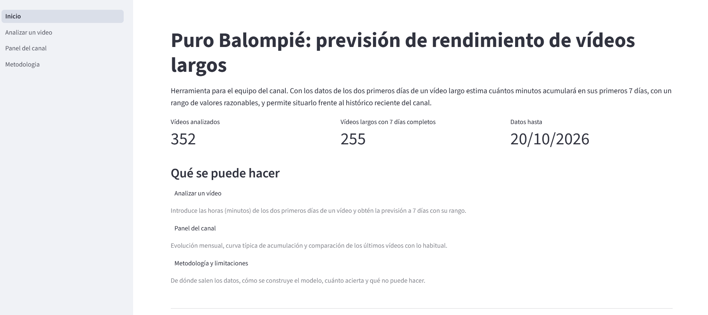
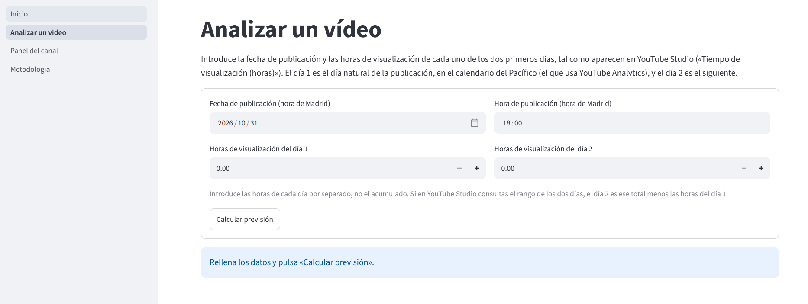
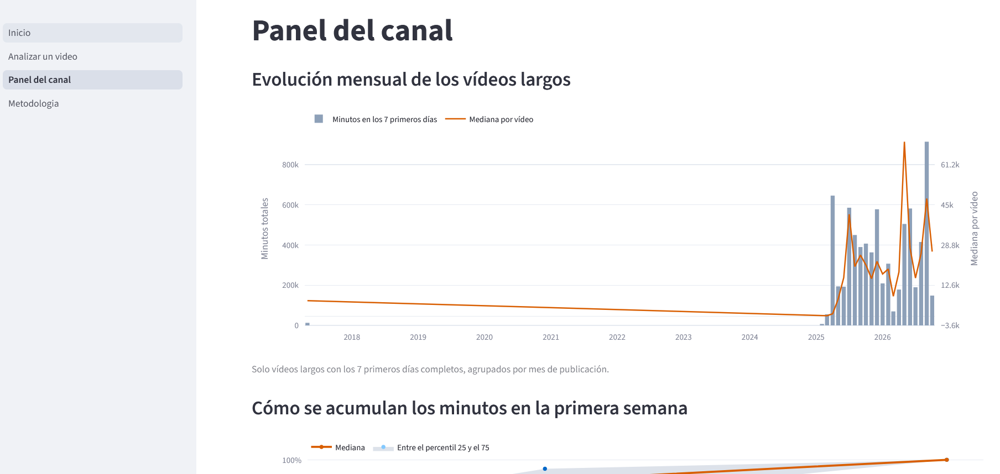
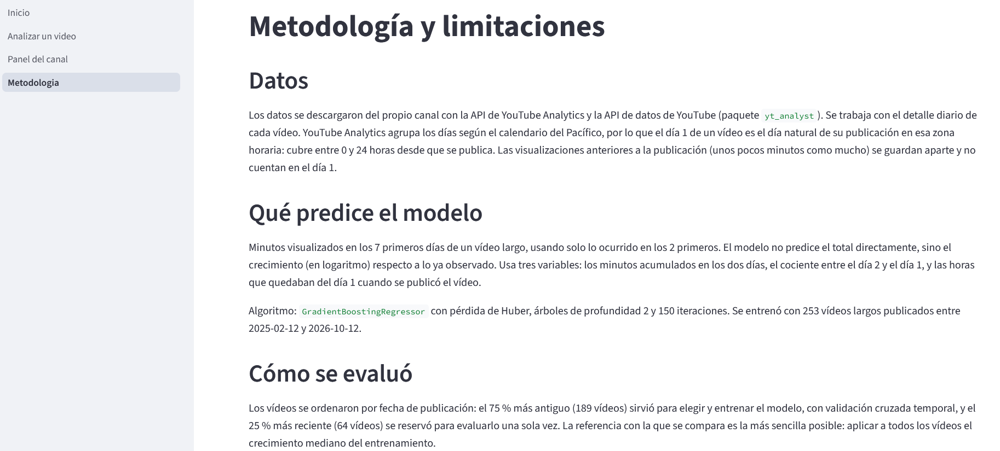

# Puro Balompié: previsión de rendimiento de vídeos largos

Con los datos de los dos primeros días de un vídeo largo del canal de YouTube **Puro Balompié**, el proyecto estima cuántos minutos visualizados acumulará en sus 7 primeros días, con un rango de valores razonables, y permite compararlo con el histórico reciente del canal. Incluye el análisis completo (cuadernos) y una aplicación web local en Streamlit.

---

## 1. Problema y usuarios

**Problema.** Un vídeo largo recibe casi la mitad de sus minutos de visualización en el primer día y tres cuartas partes en los dos primeros. Saber pronto si un vídeo va a rendir por encima o por debajo de lo habitual ayuda a decidir cómo promocionarlo y a comparar vídeos entre sí. Una cifra única de previsión transmite una precisión que no existe, así que la herramienta da una estimación y un rango.

**Usuarios.** El equipo de contenido del canal, que publica vídeos largos y quiere valorar su rendimiento a partir de lo que ya ha ocurrido en sus dos primeros días en YouTube Studio.

**Alcance.** Vídeos largos publicados desde 2025. La previsión necesita los dos primeros días completos del vídeo; no sirve para decidir antes de publicar.

---

## 2. Origen de los datos

Los datos son del propio canal y se descargaron los días 23 y 24 de octubre de 2026 con dos servicios de Google:

- **YouTube Analytics API**: métricas diarias por vídeo (visualizaciones, minutos visualizados, suscriptores, ingresos, etc.).
- **YouTube Data API**: datos de cada vídeo (título, fecha de publicación, duración, estado de privacidad, etc.).

El acceso se hizo con un rol de lector y analista del canal mediante OAuth. La descarga la realiza el paquete propio `yt_analyst/` de este repositorio, que guarda los datos en bruto (JSON), genera los CSV y registra su progreso en un archivo de control, de modo que puede reanudarse. Los datos llegan hasta unos días antes de la descarga, porque Analytics tarda en consolidar las cifras (el retraso se configura con `END_DATE_LAG_DAYS`, 3 días por defecto).

**Tablas incluidas.** `data/csv/` contiene los 23 CSV generados:

| Grupo | Archivos |
|---|---|
| Datos del canal y de los vídeos (YouTube Data API) | `channel.csv`, `videos.csv` (un vídeo por fila) |
| Resumen por vídeo | `video_performance.csv`: una fila por vídeo, generada por `yt_analyst`. Une los datos del vídeo de la Data API (título, fecha, duración, formato, etiquetas, privacidad), las métricas totales de Analytics (visualizaciones, minutos, suscriptores, ingresos) y ratios calculados (horas de visualización y «me gusta», comentarios, compartidos y suscriptores netos por cada mil visualizaciones) |
| Analytics por vídeo | `analytics_video_daily.csv` (métricas diarias), `analytics_video_totals.csv` (totales), `analytics_video_retention.csv` (retención), `analytics_video_traffic_source.csv` (fuentes de tráfico), `analytics_video_subscribed_status.csv` (suscritos y no suscritos), `analytics_video_country.csv` (país) |
| Ingresos por vídeo | `analytics_video_revenue_daily.csv` (diarios), `analytics_video_revenue_totals.csv` (totales), `analytics_video_country_revenue.csv` (por país) |
| Analytics del canal | `analytics_channel_daily.csv` (métricas diarias), `analytics_channel_content_type.csv` y `analytics_channel_content_type_daily.csv` (tipo de contenido), `analytics_channel_traffic_source.csv` (fuentes de tráfico), `analytics_channel_subscribed_status.csv` (suscritos y no suscritos), `analytics_channel_country.csv` (país), `analytics_channel_demographics.csv` (demografía), `analytics_channel_device_type.csv` (dispositivo), `analytics_channel_operating_system.csv` (sistema operativo) |
| Ingresos del canal | `analytics_channel_revenue_daily.csv` (diarios), `analytics_channel_country_revenue.csv` (por país) |

**Privacidad.** Antes de incluir los CSV en el repositorio se excluyeron los 18 vídeos que no son públicos (14 privados y 4 no listados) con `src/preparar_entrega.py`: `videos.csv` pasa de 375 a 357 vídeos y las tablas por vídeo pierden sus filas. Las tablas a nivel de canal (agregados) no se modifican. Los datos de ingresos sí están incluidos. Las credenciales no se incluyen: `.env` está fuera del repositorio y se ofrece `.env.example` como plantilla.

**Cómo repetir la descarga** (opcional, no hace falta para ejecutar el proyecto):

1. Instalar las dependencias de extracción: `pip install -r requirements-extraccion.txt`.
2. Copiar `.env.example` a `.env` y rellenar `YT_CLIENT_ID`, `YT_CLIENT_SECRET` y `YT_REFRESH_TOKEN`.
3. Ejecutar la descarga con `python -m yt_analyst run`, que descarga los datos de las APIs (JSON en bruto) y después genera los CSV. Si se interrumpe, se reanuda volviendo a ejecutarlo. Subcomandos disponibles:
   - `python -m yt_analyst extract`: solo descarga los datos en bruto, de forma reanudable.
   - `python -m yt_analyst transform`: genera los CSV desde el JSON ya descargado, sin llamar a la API.
   - `python -m yt_analyst status`: muestra el resumen del checkpoint (tareas hechas y fallidas).
4. Los resultados quedan en `data/extraction/` (carpeta que no se entrega). Para obtener los CSV de `data/csv/` sin los vídeos no públicos: `python src/preparar_entrega.py`, que lee `data/extraction/csv/` y escribe en `data/csv/` (sin argumentos).

---

## 3. Preprocesamiento y análisis exploratorio

Está en `notebooks/01_preprocesamiento.ipynb` y `notebooks/02_eda.ipynb`. El primero genera `data/processed/videos_maestra.csv` (una fila por vídeo, 352 vídeos) y `data/processed/panel_diario.csv` (una fila por vídeo y día, 128.489 filas).

### Decisiones de preprocesamiento

- **Día 1 = día de publicación en el calendario del Pacífico.** YouTube Analytics agrupa los días a partir de las 00:00 hora del Pacífico, no de Madrid. El día 1 de un vídeo es, por tanto, un día natural parcial: cubre entre 0 y 24 horas desde la publicación. Las visualizaciones anteriores a la publicación (de 1 a 29 minutos, típicamente) se guardan aparte y no cuentan en el día 1.
- **Ventanas de 1, 2, 3, 7 y 28 días desde la publicación.** Una ventana incompleta (los datos no la cubren entera) se deja como dato ausente y no se rellena. Cada ventana de 7 y 28 días se etiqueta como anterior, posterior o mixta respecto al cambio de criterio de visualizaciones del 24/08/2026.
- **Solo vídeos largos para el modelo.** Se excluyen los 3 directos y los vídeos no públicos. Los 7 vídeos largos de duración breve se mantienen con una marca (`largo_breve`).
- **Población de modelado.** 260 vídeos largos, 255 con los 7 días completos, 253 publicados desde 2025: dos vídeos de 2017 quedan fuera por ser casos aislados, ocho años anteriores al resto.

### Hallazgos del análisis exploratorio

- **Los primeros días concentran el resultado.** La mediana de los minutos acumulados es de aproximadamente el 47,5 % al terminar el día 1, el 76,3 % el día 2 y el 87,1 % el día 3 (sobre los vídeos con referencia). El 93 % de los minutos de los 28 primeros días ocurre antes del día 7.
- **El día de la semana y la franja horaria no muestran efecto** sobre el rendimiento relativo (contraste de Kruskal-Wallis: p = 0,089 por día de la semana, p = 0,586 por franja).
- **Fuente de tráfico principal.** La etiqueta `SUBSCRIBER` de la API agrupa los *feeds* de la página de inicio y las funciones de suscripción, y aporta en torno al 60 % de las visualizaciones en los tres grupos de vídeos por rendimiento que se comparan (60,0 %, 59,9 % y 57,8 %). El canal depende sobre todo de lo que YouTube le muestra en el inicio y en las suscripciones.
- **Los vídeos de mayor rendimiento tienen una proporción *menor* de espectadores suscritos** (correlación de Spearman de −0,42): crecen al llegar a gente que no los seguía.
- **Hay un cambio de criterio de visualizaciones el 24/08/2026** que afecta a las series y no se ha podido corregir (ver apartados 4 y 8).

---

## 4. Enfoque de ciencia de datos, métricas y límites

Está en `notebooks/03_modelo.ipynb`, y el código reutilizable en `src/modelo.py`.

### Planteamiento

- **Objetivo:** `minutos_7d`, los minutos visualizados en los 7 primeros días, modelados en escala logarítmica por su gran dispersión.
- **Qué se predice:** el *crecimiento* respecto a los dos primeros días, `log(1 + minutos_7d) − log(1 + minutos_2d)`. La predicción en minutos se reconstruye a partir de lo ya observado.
- **Entradas (solo los 2 primeros días):** minutos acumulados en los dos días, cociente entre el día 2 y el día 1 (velocidad del vídeo) y horas del día 1 que quedan desde la publicación hasta la medianoche del Pacífico. Se excluyen los totales por vídeo, la retención, las fuentes de tráfico, los ingresos y toda cifra posterior al día 2, porque filtrarían el futuro al modelo.
- **Referencia con la que se compara:** aplicar a todos los vídeos el crecimiento mediano del entrenamiento. A los 2 días ya se conoce, en mediana, el 76 % del resultado, así que es una referencia exigente.
- **Modelo final:** `GradientBoostingRegressor` (pérdida de Huber, 150 árboles de profundidad 2, tasa de aprendizaje 0,03), elegido por validación cruzada temporal frente a regresiones Ridge y a la referencia. Se reajusta con los 253 vídeos y se guarda en `models/modelo_prevision_2d.joblib`.

### Validación

- **Partición temporal:** el 75 % más antiguo (189 vídeos, de 12/02/2025 a 14/04/2026) entrena y el 25 % más reciente (64 vídeos, de 17/04/2026 a 12/10/2026) evalúa, una sola vez.
- **Selección del modelo:** validación cruzada temporal (5 pliegues, con un hueco de 3 vídeos entre entrenamiento y validación). El modelo elegido mejora a la referencia en los 5 pliegues.

### Resultados en los 64 vídeos de prueba

| Métrica | Referencia | Modelo |
|---|---|---|
| Error medio en logaritmo (7 días) | 0,184 | 0,156 |
| Error relativo mediano | 12,8 % | 10,6 % |
| R² en logaritmo | 0,913 | 0,944 |
| Error en los minutos que llegan después de los 2 días | 0,779 | 0,673 |

El error medio baja un **15,2 %** (intervalo al 90 % por remuestreo: 8,8 % a 20,3 %) y el modelo se equivoca menos que la referencia en 43 de los 64 vídeos. La mejora se mantiene entre el 13,8 % y el 16,9 % al quitar el vídeo más grande, al quitar los largos breves y al separar los vídeos con ventana anterior o posterior al 24/08/2026. Es una mejora real pero moderada: la mayor parte de la información ya está en los minutos de los dos primeros días. La variable que más pesa es la velocidad del vídeo (cociente día 2 / día 1).

### Rango de la previsión

Se calcula con los errores que el modelo comete con vídeos que no ha visto (validación temporal): un intervalo del 80 % que equivale a multiplicar la estimación por 0,79 y 1,35 y que nunca baja de los minutos ya observados. Calibrado solo con el entrenamiento, contiene el valor real en el 87,5 % de los vídeos de prueba: ninguno queda por debajo y el 12,5 % queda por encima. El rango informa sobre todo por arriba y se queda algo corto en los vídeos que se disparan.

### Límites

- Hacen falta los 2 primeros días del vídeo, con su fecha y hora de publicación.
- La prueba tiene solo 64 vídeos, y las cifras tienen una incertidumbre apreciable.
- Tras el cambio de criterio del 24/08/2026 el error absoluto es mayor, tanto en el modelo como en la referencia.
- Un único canal; el modelo no incluye el contenido del vídeo, ni impresiones, ni CTR (no están en los datos descargados).
- El canal creció mucho en 2025 y 2026, y el modelo no se ha probado con vídeos mucho mayores que los vistos.
- El día 1 es parcial y su duración depende de la hora de subida.
- El modelo anticipa un volumen de minutos; no explica por qué un vídeo funciona mejor.

---

## 5. Uso de la aplicación

Aplicación web local en Streamlit, con cuatro páginas. Se arranca con un solo comando (ver apartado 6).

### Inicio

Resumen del proyecto y enlaces a las demás páginas.



### Analizar un vídeo

Se introducen la fecha y hora de publicación (hora de Madrid) y las **horas de visualización** del día 1 y del día 2, tal como aparecen en YouTube Studio («Tiempo de visualización (horas)»), cada día por separado y no el acumulado. La aplicación convierte las horas a minutos (×60) antes de usar el modelo, que trabaja siempre en minutos; los resultados de esta página se muestran en horas por comodidad.

Devuelve:

- la estimación a 7 días y su rango al 80 %;
- cuántas veces se espera que el vídeo multiplique lo ya observado;
- la posición de la estimación entre los últimos 50 vídeos largos del canal, con un histograma;
- avisos si procede: ventana de 7 días que incluye el 24/08/2026 o posterior, tamaño fuera del rango del entrenamiento, día 1 casi vacío por publicarse cerca de la medianoche del Pacífico, o un día con 0 horas.

La página no calcula la previsión si los dos primeros días no han terminado todavía en el calendario del Pacífico.



### Panel del canal

Evolución mensual de los vídeos largos (minutos totales y mediana por vídeo), curva típica de acumulación de minutos en la primera semana, y una tabla con los últimos vídeos frente a lo esperado por el modelo. Estos vídeos formaron parte del entrenamiento, por lo que la tabla describe cuáles se alejaron de lo habitual, no mide la precisión del modelo. Este panel trabaja en minutos.



### Metodología y limitaciones

Resumen de los datos, el método, las métricas y las limitaciones, con las cifras del cuaderno 03.



---

## 6. Instalación y ejecución

Probado con **Python 3.14.3**. Todos los comandos se ejecutan desde la raíz del proyecto.

**1. Crear y activar un entorno virtual**

Windows (PowerShell):
```powershell
python -m venv .venv
.venv\Scripts\Activate.ps1
```

macOS / Linux:
```bash
python -m venv .venv
source .venv/bin/activate
```

**2. Instalar las dependencias** (versiones fijadas en el archivo)
```bash
pip install -r requirements.txt
```

**3. Arrancar la aplicación**
```bash
streamlit run app/Inicio.py
```
Se abre en el navegador (por defecto, en `http://localhost:8501`). El repositorio incluye los datos procesados y el modelo entrenado, por lo que la aplicación funciona sin ejecutar nada más.

**4. Reproducir el análisis** (opcional)

Abrir `notebooks/` con Jupyter o VS Code, usando el kernel del entorno `.venv`, y ejecutar en orden, con *Reiniciar y ejecutar todo*:

1. `01_preprocesamiento.ipynb`: lee `data/csv/` y genera `data/processed/`.
2. `02_eda.ipynb`: análisis exploratorio.
3. `03_modelo.ipynb`: entrena, evalúa y guarda el modelo en `models/`. Si cambia el modelo, hay que reiniciar la aplicación.

La descarga de datos desde YouTube (apartado 2) no es necesaria para ejecutar el proyecto.

---

## 7. Estructura del repositorio

```
.
├── README.md
├── requirements.txt              # dependencias de cuadernos y aplicación (versiones fijadas)
├── requirements-extraccion.txt   # dependencias adicionales para descargar los datos
├── .env.example                  # plantilla de configuración y credenciales de la extracción
├── .gitignore
├── app/
│   ├── Inicio.py                 # página de inicio (punto de entrada de Streamlit)
│   ├── utilidades.py             # rutas, carga de datos y formato comunes
│   └── pages/
│       ├── 1_Analizar_un_video.py
│       ├── 2_Panel_del_canal.py
│       └── 3_Metodologia.py
├── notebooks/
│   ├── 01_preprocesamiento.ipynb
│   ├── 02_eda.ipynb
│   └── 03_modelo.ipynb
├── src/
│   ├── modelo.py                 # variables del modelo, carga y previsión (comparte cuaderno 03 y app)
│   └── preparar_entrega.py       # filtra los vídeos no públicos de los CSV descargados
├── yt_analyst/                   # paquete de extracción de YouTube Analytics y Data API
├── data/
│   ├── csv/                      # 23 CSV de la descarga, sin vídeos no públicos
│   └── processed/                # tablas generadas por el cuaderno 01
├── models/
│   └── modelo_prevision_2d.joblib
└── docs/                         # capturas de la aplicación
```

`data/extraction/` (datos en bruto, control de la descarga y registro) lo genera `yt_analyst` y no se entrega.

---

## 8. Qué mejorar

- **Más datos del canal.** Impresiones, porcentaje de clics de las miniaturas, visualizaciones con interacción (*engaged views*), audiencia por horas y diferencia entre espectadores nuevos y recurrentes, que no se descargaron y probablemente mejorarían la previsión.
- **El cambio del 24/08/2026.** Resolver si las visualizaciones del día 1 usan ya el criterio nuevo y corregir las series; con más vídeos posteriores se podría evaluar el modelo por separado en esa etapa.
- **Más vídeos de prueba.** Cuando haya más vídeos, repetir la evaluación; con 64, la incertidumbre es grande.
- **Contenido del vídeo.** Añadir información como el tipo de contenido, que se dejó fuera por tiempo.
- **Otros horizontes.** Una segunda previsión a 28 días, con los mismos datos de entrada.
- **Recalibrar el rango.** El rango se queda algo corto por arriba en los vídeos que se disparan; se podría ajustar con más datos, o con un modelo de cuantiles.
- **Datos en vivo.** Conectar la aplicación a la API para que cargue los dos primeros días de un vídeo sin teclearlos, y reentrenar el modelo de forma periódica.
- **Despliegue.** La aplicación se ejecuta en local; alojarla para que la use todo el equipo sería el siguiente paso.
